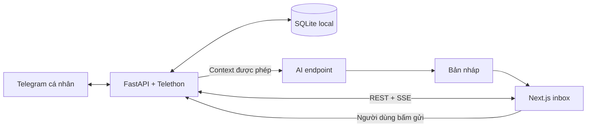

# Telegram Dashboard — Thiết kế web local

Ngày: 2026-10-29. Trạng thái: đã cập nhật lựa chọn Next.js và rà stack; chưa có product code.

## Mục tiêu và quyết định đã thống nhất

Người dùng muốn dùng chính tài khoản Telegram cá nhân để tập trung tin nhắn nhóm, trả lời ngoài ứng dụng Telegram và có AI hỗ trợ. Người dùng đã chọn web local trước, repository `phamanh1289/telegram_dashboard`, thư mục `/Users/anhpham/Documents/Telegram dashboard`. Sau đó người dùng duyệt đổi frontend sang Next.js để phát triển UI/animation và yêu cầu kiểm tra công nghệ còn lại.

Repository lúc khảo sát: nhánh `master`, commit `6511a06`, chỉ có README; không có `.codegraph/`, `AGENTS.md` trong repo hoặc `WORKING-CONTEXT.md`. Không tạo hoặc index CodeGraph tự động.

Next.js và web local là quyết định đã được người dùng duyệt. Các lựa chọn kỹ thuật còn lại bên dưới là đề xuất sau rà soát, chưa phải yêu cầu người dùng đã xác nhận từng package. Xem [biên bản rà stack](../../decisions/2026-10-29-stack-review.md) để phân biệt metadata, import smoke và những phần chưa kiểm chứng.

## Các hướng đã cân nhắc

| Hướng | Đổi lại | Quyết định |
|---|---|---|
| Web local + dịch vụ kết nối tài khoản | Cần giữ tiến trình chạy; máy ngủ thì không nhận trực tiếp | Người dùng đã chọn web local |
| Desktop app | Thêm đóng gói, phân phối và cập nhật; thuận tiện tray/autostart | Để sau khi kiểm chứng luồng chính |
| Web trên server | Có thể chạy liên tục; phải bảo vệ truy cập từ xa và session | Ngoài bản đầu |

## Kiến trúc đề xuất

- Frontend: Next.js App Router + React + TypeScript strict, Tailwind CSS v4, shadcn/ui với Base UI. Chỉ lấy components đang dùng: Button, Input, Textarea, Dialog/Sheet, Tooltip, Skeleton. Query/cache qua TanStack Query; state cục bộ dùng React, chưa cần Redux/Zustand.
- Animation: CSS cho hover/loading đơn giản; Motion for React cho mở/đóng panel và chuyển layout. Tôn trọng `prefers-reduced-motion`; không animate cả timeline dài hoặc làm mất vị trí cuộn. Không dùng dependency beta/canary chỉ vì mới.
- Runtime: Node 24 LTS với security patch hiện hành; Python 3.14.6 đã import smoke backend thành công. Quản lý Python bằng uv/uv.lock; frontend dùng npm workspaces và package-lock.json. Không đổi runtime toàn máy trong lượt lập plan.
- Backend: FastAPI + Pydantic v2 + Uvicorn. Lifespan sở hữu một Telethon client; một worker, không `--reload` khi kết nối session thật. Telegram client không chạy trong Next.js route handlers/Server Actions hoặc serverless functions.
- Telethon stable 1.45.0 là baseline đã kiểm tra import; TDLib là phương án chính thức nhưng cần native binaries/bindings. Giữ Telethon cho phạm vi Python local hiện tại; không đổi sang thư viện khác chỉ để đồng nhất ngôn ngữ.
- SQLite WAL qua `sqlite3` chuẩn, các thao tác DB chạy qua `asyncio.to_thread`; mỗi thao tác có connection riêng, transaction ngắn, busy timeout, foreign keys bật ở từng connection. Không dùng chung connection giữa threads; chưa cần ORM hoặc DB server. SQLite phù hợp ứng dụng local một người, không phải lựa chọn bị loại vì lâu đời.
- Realtime: native SSE của FastAPI và browser EventSource. SSE gửi invalidation metadata, REST trả dữ liệu có cursor/revision; không poll toàn bộ inbox mỗi 2 giây. Đóng tab không dừng thu thập Telegram.
- Types giữa backend và UI sinh từ OpenAPI bằng openapi-typescript; không viết tay hai bộ DTO độc lập. Generator chạy offline từ app factory, không kết nối session thật.
- AI tùy chọn: gọi một endpoint tương thích OpenAI Chat Completions bằng httpx ở Python, cấu hình URL/model/key ở backend. Chưa chọn provider/model; không giả định hỗ trợ mọi API mới hay thêm framework agent khi chỉ có draft/summary. Khi chốt provider sẽ kiểm tra SDK/API stable phù hợp của provider đó.

### Chế độ phát triển và chạy local

- Dev: Next ở `http://127.0.0.1:3000`, Python ở `127.0.0.1:8765`. Next rewrites `/api/:path*` sang Python; browser chỉ gọi URL tương đối cùng origin. `APP_ORIGIN` ở backend là origin 3000. Kiểm tra SSE đi qua proxy không bị buffer; không mở CORS wildcard để chữa lỗi proxy.
- Bản build local: Next `output: "export"` sinh `web/out`; FastAPI phục vụ UI tĩnh và `/api` tại `http://127.0.0.1:8765`. Chạy một Python process, không cần Next server ở runtime. Dev config không bật export; build config không khai báo rewrites/headers/server-only features vì chúng không được static export hỗ trợ.
- Dashboard chỉ có page `/`; chọn chat bằng state/query string, không dựng dynamic route cần `generateStaticParams`. UI tương tác là Client Components; browser API chỉ chạy sau mount. Static shell/build không đọc Telegram/AI/private API, không đưa dữ liệu tài khoản vào HTML/RSC build output.
- Cookie, xác thực và API đều do FastAPI quản lý tại runtime. Không dùng Next server cookies API, Server Actions, SSR riêng tư hoặc Next route handlers trong build export. Dùng font hệ thống; chưa tải avatar/media từ xa.
- API routes và API 404 đăng ký trước static mount, để lỗi `/api/...` không biến thành HTML status 200. Root scripts dự kiến `npm run dev`, `npm run build`, `npm start`; script dev dùng Node child_process quản lý hai tiến trình và dừng cả hai khi Ctrl+C.

## Phạm vi bản đầu

1. Một tài khoản, một người dùng trên máy; xác thực Telegram bằng CLI, nhập mã/2FA trực tiếp trên máy. Web chỉ hiện trạng thái kết nối; không thu OTP trong chat với agent.
2. Liệt kê nhóm/supergroup tài khoản tham gia, chọn nhóm theo dõi. Không tự quét tin nhắn riêng, channel, Saved Messages hoặc mọi nhóm.
3. Khi chọn nhóm, ghi thời điểm bắt đầu và nạp tối đa 50 tin gần nhất mà tài khoản được phép đọc. Hiển thị rõ đây là lịch sử khởi tạo có giới hạn, không phải archive đầy đủ.
4. Lưu tin mới cả chiều nhận và chiều gửi; hiển thị text/caption, tên người gửi nếu có, thời gian và quan hệ reply. Với người gửi ẩn danh/channel, dùng danh tính Telegram thực sự cung cấp, không suy diễn người thật.
5. Ảnh/file/voice/sticker chỉ hiện loại và metadata cơ bản; chưa tải, OCR, phát hoặc gửi file. Topic được giữ trong dữ liệu; reply đúng topic khi phản hồi tin có sẵn. Chưa có trình duyệt topic riêng hoặc chủ động tạo tin trong topic bất kỳ.
6. Tìm kiếm text trong dữ liệu đã lưu của các nhóm được chọn; phân trang 50, tối đa 100 tin mỗi request. API dùng chuỗi cho Telegram IDs để tránh mất độ chính xác ở JavaScript. `chat_id` luôn là marked peer ID (Telethon `utils.get_peer_id`: nhóm thường âm, supergroup `-100…`), không dùng raw chat/channel ID vì hai loại có thể trùng số.
7. Nhập câu trả lời, xem rõ nhóm/tin đích, bấm gửi. Enter xuống dòng; Ctrl/Cmd+Enter gửi. UI giữ nội dung nếu gửi lỗi.
8. AI soạn nháp hoặc tóm tắt tối đa 30 tin do người dùng chọn trong cùng một nhóm. AI không có công cụ gửi tin; người dùng chỉnh và duyệt gửi qua cùng luồng thủ công.

## Lưu trữ và đồng bộ

- `chats`: ID, tên, trạng thái theo dõi, thời điểm chọn, collection generation và history checkpoint. History checkpoint độc lập với tin live mới nhất; chỉ tăng trong cùng transaction lưu xong một batch lịch sử theo thứ tự tăng ID. Live handler không được đẩy checkpoint qua khoảng chưa scan. Mỗi lượt recovery chụp upper bound trước khi scan.
- `messages`: khóa `(chat_id, message_id)`, sender ID/name, text/caption, UTC timestamp, edit timestamp, reply/topic ID, chiều gửi, media kind, deletion status. Không lưu raw update hoặc số điện thoại mặc định.
- `outbox`: UUID từ browser, chat/reply ID, nội dung, Telegram `random_id`, trạng thái `pending/sending/sent/failed/unknown`, Telegram message ID và mã lỗi an toàn. UUID trùng với payload khác trả 409.
- `changes`: revision tăng toàn cục và metadata `(chat_id, message_id, kind, generation)`, không lưu bản sao text; `message_id` rỗng với thay đổi cấp nhóm (theo dõi/bỏ theo dõi/purge). Ghi changes trong cùng transaction với message/outbox mutation rồi mới đánh thức SSE subscribers; rollback không được phát notification. API snapshot trả snapshot_cursor từ cùng read transaction với dữ liệu.
- `metadata`: schema version và db_epoch UUID. Một định dạng duy nhất cho change cursor là `<db_epoch>:<revision>` (UUID và số nguyên thập phân). SSE event ID, Last-Event-ID, query cursor, snapshot_cursor và next_cursor dùng nguyên chuỗi này. Epoch đổi khi reset DB nên cursor cũ phải reset kể cả số revision trùng hoặc database mới đã vượt revision cũ.
- `ai_permissions`: grant theo từng `(chat_id, message_id, content_hash)`, phạm vi, hạn hiệu lực, trạng thái thu hồi, các bên liên quan đã được xác định và tham chiếu bằng chứng đồng ý của từng người. Mặc định không có grant. Chỉ eligibility chính xác cho phiên bản nội dung hiện tại mới cho phép gọi AI; đây là guard kỹ thuật, không tự chứng minh đáp ứng điều khoản.
- Bản nháp AI giữ trên browser trong phiên hiện tại; không dựng kho embedding/vector hoặc lưu transcript AI riêng ở bản đầu.
- Bật `catch_up=True`, đăng ký handlers trước khi kết nối; nhận bù updates có thể nhận được. Upsert chống trùng; update đến muộn không ghi đè phiên bản đã sửa mới hơn hoặc làm sống lại tin đã xóa.
- Sau gián đoạn, kiểm tra thêm lịch sử mới kể từ mốc đã lưu trong nhóm được chọn; nếu recovery quá lớn, làm theo batch và hiện đang đồng bộ thay vì khóa UI. Không cam kết phục hồi tin đã mất quyền xem, tự hủy hoặc bị xóa trước khi nhận.
- Khi nhận được sự kiện sửa/xóa xác định được đích, cập nhật nội dung hoặc xóa nội dung, chỉ giữ tombstone tối thiểu. Sự kiện xóa không đủ chat context phải được đối chiếu định danh đáng tin cậy; không xóa theo message ID đơn lẻ trên mọi nhóm. Cụ thể: xóa ở supergroup luôn kèm channel ID; xóa thiếu chat ID chỉ đến từ chat không phải channel (nhóm thường), nơi message ID duy nhất theo tài khoản, nên chỉ đối chiếu trong các nhóm thường đang theo dõi, không bao giờ chạm supergroup.
- Nhóm thường nâng cấp thành supergroup sẽ đổi chat ID và dãy message ID. Bản đầu đánh dấu nhóm cũ là đã chuyển, dừng thu thập và yêu cầu người dùng chọn lại nhóm mới; không tự gộp dữ liệu hai ID. Telegram không bảo đảm thông báo mọi lần xóa; UI/tài liệu phải nói rõ giới hạn này.
- Bỏ theo dõi dừng thu thập mới; nút riêng cho phép xóa dữ liệu nhóm khỏi DB. Xóa dữ liệu trước hết dừng tracking và tăng generation, hủy tác vụ chưa gửi, vô hiệu grant, xóa nội dung messages/outbox và chỉ giữ metadata tối thiểu cho gửi chưa rõ kết quả. Late callbacks phải kiểm tra generation để không ghi nội dung trở lại. Tác vụ đang truyền sang Telegram có thể đã gửi, không hứa hủy/thu hồi được. Sự kiện xóa một tin cũng purge nội dung outbox liên quan và vô hiệu grant. Dữ liệu local tồn tại tới khi người dùng xóa; chưa có backup tự động, chưa cam kết forensic erasure khỏi ổ đĩa/WAL/backup bên ngoài.

### SSE và UI cache

`GET /api/events` dùng cookie local, không token trong URL; event ID là change cursor chứa cả db_epoch và revision bền vững trong DB. Stream chứa invalidation metadata và trạng thái kết nối, không text. Dùng native `EventSourceResponse`/`ServerSentEvent`, keepalive và disconnect cancellation, không thêm sse-starlette khi FastAPI đã đáp ứng.

Client lấy snapshot_cursor rồi mở SSE từ cursor đó. Giữ riêng last_applied_cursor chỉ tăng sau khi REST changes đã apply thành công; SSE Last-Event-ID là vị trí notification, không được coi là bằng chứng đã apply dữ liệu. Sau reconnect/refocus phải drain từ last_applied_cursor kể cả khi SSE không phát notification mới. Auto-reconnect ưu tiên `Last-Event-ID`; khi tạo EventSource mới sau khi tab hiện lại dùng query cursor không nhạy cảm. Server replay metadata còn trong DB; cursor không hợp lệ hoặc sau reset DB thì phát `reset`, client bỏ cache và lấy snapshot mới. Read changes theo batch qua một change feed toàn cục (mọi nhóm đang theo dõi), vì revision và last_applied_cursor là toàn cục; feed theo từng nhóm sẽ làm cursor bỏ qua thay đổi của nhóm khác. SSE chỉ đánh thức việc drain changes, không thay cho DB. Một condition/bounded wakeup signal chỉ là notification; DB revision là nguồn khôi phục, tránh dựa vào queue RAM có thể mất sau restart. Mất wakeup không được treo: heartbeat đồng thời kiểm tra revision mới trong DB. Không giữ lock/transaction SQLite trong lúc chờ stream.

Client chỉ mở một EventSource khi đã unlock và tab hiển thị; đóng khi hidden/logout và reconnect khi hiện. TanStack Query giữ cache trong RAM; query key bao gồm chat/search/cursor, fetch dùng AbortSignal và networkMode:"always" để localhost vẫn đọc được khi browser báo offline. Safe GET chỉ retry tối đa một lần; lỗi auth không retry. Khi untrack/purge/logout hoặc SSE trả reset, xóa cache tương ứng và hủy fetch cũ. Mutation send/AI dùng `retry:false`, `networkMode:"always"`, không persist/resume offline mutations; kết nối trở lại không tự gửi tin. Quyết định gửi sau lỗi vẫn do người dùng và outbox quyết định.

## Luồng gửi đáng tin cậy

API ghi outbox trước khi gọi Telegram, dùng unique UUID và atomic state claim để chỉ một caller được gửi. Một request UUID tương ứng một Telegram `random_id` cố định; retry cùng tác vụ phải dùng lại request và `random_id`, không gọi lại helper tạo ID mới. Caller trùng đang xử lý nhận trạng thái hiện tại, không thêm RPC. Lưu kết quả thành công hoặc trạng thái chưa xác định nếu timeout. Sau crash, tác vụ `sending` chuyển `unknown`, không gửi lại tự động; tác vụ `pending` chưa được claim thì chắc chắn chưa gọi Telegram nên chuyển `failed`, người dùng có thể gửi lại cùng request. Chỉ reconcile bằng RPC result hoặc mapping random_id/message ID do Telegram cung cấp nếu quan sát được; không suy đoán theo text/thời gian. Nếu không có bằng chứng thì giữ unknown. `RANDOM_ID_DUPLICATE` cũng giữ unknown nếu chưa có message ID, không báo chưa gửi hoặc tạo ID khác. UI cho phép yêu cầu retry cùng tác vụ sau khi giải thích chưa rõ kết quả; nếu payload đã purge thì không thể retry, chỉ kiểm tra ngoài Telegram.

Đặt giới hạn một lượt gửi đang chạy cho tài khoản ở bản đầu. Cấu hình Telethon `flood_sleep_threshold=0`, `request_retries=0` để không tự chờ rồi gọi lại RPC gửi; connection auto-reconnect có thể bật và mọi transport retransmission giữ nguyên random_id. FloodWait/SlowMode được trả ra dưới dạng `retry_after`, UI đếm thời gian và không tự gửi sau khi hết hạn. Kiểm tra nhóm đang được chọn và reply target thuộc đúng nhóm trước mọi thao tác gửi. Tin đang xóa hoặc không còn quyền truy cập phải báo lỗi cụ thể.

## Bảo vệ session và dữ liệu

- Chỉ bind loopback: Python `127.0.0.1:8765`, Next dev `127.0.0.1:3000`; không publish qua LAN/tunnel trong bản đầu.
- `.env`, `data/`, session, SQLite/WAL/SHM, log chứa dữ liệu, `.venv/` đều bị gitignore từ trước lần login đầu. Quyền thư mục dữ liệu 0700, file session/config nhạy cảm 0600. Không xem SQLite/session là đã mã hóa; dựa vào quyền máy và mã hóa ổ đĩa của người dùng.
- Server kiểm tra Host và APP_ORIGIN chính xác theo chế độ dev/build; chỉ phục vụ UI/API cùng origin, không mở CORS `*`. Host hợp lệ của Python là `127.0.0.1:8765` ở cả hai chế độ (Next dev proxy chuyển request tới upstream; kiểm chứng header thực tế qua proxy), còn Origin phải bằng APP_ORIGIN. Chỉ hỗ trợ URL `127.0.0.1`; mở bằng `localhost` sẽ sai Origin nên mutation bị từ chối, README phải ghi rõ. Không tin origin/forwarded header do browser tự khai để quyết định upstream. Tạo mã mở khóa local ngẫu nhiên khi chạy, người dùng nhập vào UI; đổi thành cookie HttpOnly/SameSite=Strict, Path=/api. Không đưa mã vào URL, localStorage hoặc log request body. API riêng tư và SSE yêu cầu cookie; health không chứa thông tin tài khoản, unlock có giới hạn thử. SSE/GET không bắt buộc Origin header nếu browser không gửi, nhưng Origin nếu có phải hợp lệ. Mutating API luôn yêu cầu Origin đúng APP_ORIGIN.
- Nội dung Telegram/AI hiển thị bằng React text interpolation, không `dangerouslySetInnerHTML`/raw Markdown. Truy vấn SQL dùng parameters. Private responses dùng `Cache-Control: private, no-store`; SSE thêm `no-transform` và chống proxy buffering. Không service worker/offline persistence cho tin nhắn trong bản đầu.
- Nội dung hội thoại là dữ liệu không đáng tin cậy, không phải chỉ thị agent. Không gửi session, api_hash, mã xác thực, 2FA hoặc key AI cho model. Lỗi provider không trả nguyên request/secret lên browser.
- Không mặc định mở web và tự đăng nhập tài khoản thật trong lúc phát triển; kiểm chứng live chỉ khi người dùng nhập thông tin trên máy và chỉ gửi khi họ yêu cầu/bấm gửi.

## Điều kiện sử dụng AI

Telegram API Terms §1.5 và Content Licensing hiện hạn chế dùng dữ liệu Telegram trong phát triển/triển khai AI; ngoại lệ được mô tả đòi hỏi sự đồng ý rõ ràng, có hiểu biết và liên tục của từng người liên quan trong phạm vi cụ thể. Không xem bật checkbox, admin cho phép, không training hoặc AI local là tự động đủ điều kiện.

Vì vậy phần thu/đọc/gửi hoạt động độc lập. AI mặc định tắt; chỉ gửi từng message ID có grant đúng content hash, đúng chat, còn hiệu lực, chưa thu hồi và có evidence reference cho mọi người liên quan được xác định trong scope. Chưa xác định đủ người liên quan hoặc phạm vi thì không tạo grant; bản đầu không tự cấp grant cho forwarded content/media. Sửa/xóa tin vô hiệu grant; thay đổi/thu hồi quyền trong lúc request đang chạy khiến kết quả bị bỏ, dù nội dung đã gửi đi không thể thu hồi khỏi provider. Khi chưa đủ điều kiện, demo AI bằng dữ liệu giả, không gọi provider trên tin nhóm thật. Việc dùng dữ liệu cho client cũng cần phù hợp quyền và quy định của nhóm.

## Tiêu chí hoàn thành

- Từ clone sạch: `uv sync --locked`, `npm ci`, build frontend, chạy kiểm tra, đăng nhập Telegram qua CLI và mở inbox bằng README. Dev và bản build local đều được kiểm chứng riêng; static export không chứa dữ liệu tài khoản.
- Nhóm không được chọn không ghi vào DB. Tin cùng message ID ở hai nhóm không đè nhau. Sửa/xóa nhận được phản ánh đúng đích.
- Restart/mất mạng không làm trùng dữ liệu; trạng thái đồng bộ và lỗi nhận/gửi hiển thị được.
- Reply thủ công xuất hiện đúng nhóm, đúng tin/topic, dưới tài khoản cá nhân; duplicate click không tạo hai tin.
- Thiếu cấu hình AI không làm hỏng inbox. AI bị tắt/phạm vi chưa hợp lệ không gọi provider; bản nháp không tự gửi.
- Không có session/key/nội dung Telegram trong Git hoặc logs ứng dụng; request từ origin khác bị chặn.
- Test tự động dùng fake transport/provider trong tiến trình, không cần Telegram credentials; live smoke test ghi bằng chứng riêng, không đánh đồng test fake với kết quả tài khoản thật.
- SSE replay/reset cập nhật đúng tin mới/sửa/xóa; animation không làm mất focus/draft/scroll và reduced-motion hoạt động. Frontend typecheck/lint/build, API type generation và Playwright focused smoke phải pass trước khi gọi UI hoàn thành.

## Nguồn đã đối chiếu

- [Telegram application credentials](https://core.telegram.org/api/obtaining_api_id), [user authorization](https://core.telegram.org/api/auth).
- [Updates và recovery](https://core.telegram.org/api/updates), [messages.sendMessage](https://core.telegram.org/method/messages.sendMessage).
- [Telegram API Terms](https://core.telegram.org/api/terms), [Content Licensing/AI](https://telegram.org/tos/content-licensing).
- [Telethon sessions](https://github.com/LonamiWebs/Telethon/blob/v1/readthedocs/concepts/sessions.rst), [events/deletion limits](https://github.com/LonamiWebs/Telethon/blob/v1/readthedocs/quick-references/events-reference.rst), [updates implementation](https://github.com/LonamiWebs/Telethon/blob/v1/telethon/client/updates.py).
- [FastAPI lifespan](https://fastapi.tiangolo.com/advanced/events/), [native SSE](https://fastapi.tiangolo.com/tutorial/server-sent-events/), [static files](https://fastapi.tiangolo.com/tutorial/static-files/).
- [Next.js static export và giới hạn](https://nextjs.org/docs/app/guides/static-exports), [Client Components](https://nextjs.org/docs/app/getting-started/server-and-client-components), [shadcn Base UI mặc định](https://ui.shadcn.com/docs/changelog/2026-07-base-ui-default), [Tailwind Next.js](https://tailwindcss.com/docs/installation/framework-guides/nextjs), [Motion React](https://motion.dev/docs/react).
- [TanStack mutation defaults](https://tanstack.com/query/latest/docs/framework/react/guides/mutations), [network modes](https://tanstack.com/query/latest/docs/framework/react/guides/network-mode), [openapi-typescript](https://openapi-ts.dev/introduction), [uv](https://docs.astral.sh/uv/), [SQLite use cases](https://sqlite.org/whentouse.html).
